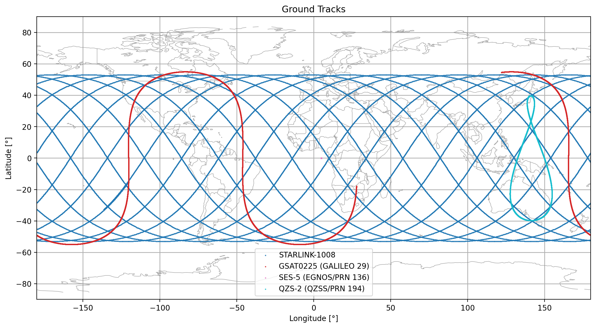
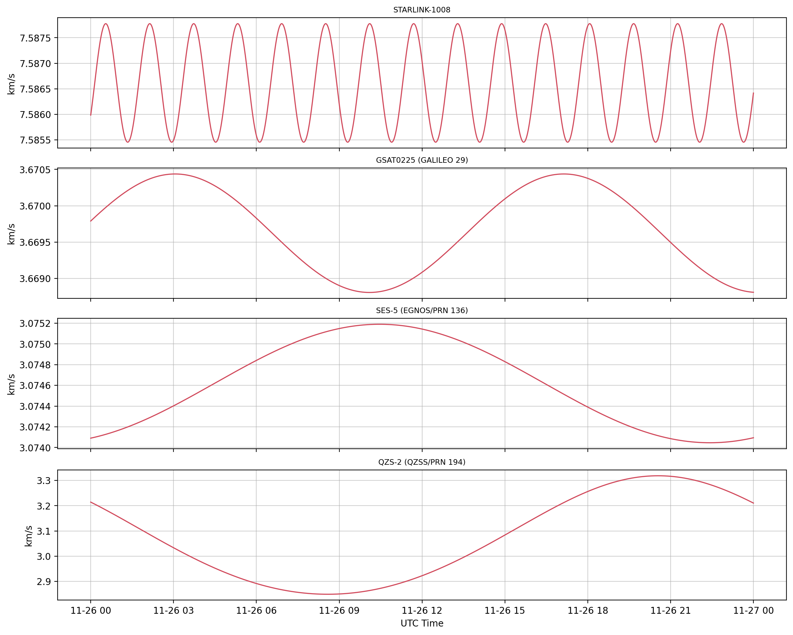

# Multi-Constellation Satellite Orbit & Ground Track Visualizer

A lightweight Python toolkit for SGP4/SDP4 orbital propagation, 2D ground track mapping, kinematic time-series analysis, and 3D geospatial KML export. Designed for Flight Dynamics and Mission Analysis applications, this script processes Two-Line Element sets (TLE) across LEO, MEO, GEO, and IGSO regimes to generate publication-ready plots and interactive 3D orbit visualization files.

---

## Executive Summary (Multi-Regime Propagation Benchmarking)

The framework was evaluated using a 24-hour propagation window across four distinct satellite operational regimes: **STARLINK-1008** (LEO), **GSAT0225 / Galileo 29** (MEO), **SES-5** (GEO), and **QZS-2** (IGSO).

| Satellite | Regime | Semi-Major Axis $a$ [km] | Inclination $i$ [deg] | Orbit Period [h] | Ground Track Pattern |
| :--- | :---: | :---: | :---: | :---: | :--- |
| **STARLINK-1008** | **LEO** | `6925.3` | `53.054°` | **`1.593 h`** | Dense global grid coverage within $[-53^\circ, +53^\circ]$ latitude. |
| **GSAT0225 (Galileo 29)** | **MEO** | `29600.2` | `54.987°` | **`14.078 h`** | Wide sinusoidal trace across medium Earth orbit altitudes. |
| **SES-5 (EGNOS/PRN 136)** | **GEO** | `42165.3` | `0.056°` | **`23.935 h`** | Quasi-stationary point lock over the equatorial line. |
| **QZS-2 (QZSS/PRN 194)** | **IGSO** | `42159.8` | `39.752°` | **`23.931 h`** | Asymmetric "Figure-8" pattern optimized for regional Asia-Pacific coverage. |

---

## Key Architectural Features

1. **Analytical Propagation Engine (SGP4/SDP4):**
   * Parses raw TLE structures and executes analytical orbital propagation accounting for Earth oblateness ($J_2, J_3, J_4$), atmospheric drag, and solar/lunar gravitational third-body perturbations.

2. **Dual-Frame Coordinate Transformation:**
   * Transforms orbital state vectors between **Earth-Centered Inertial (ECI / TEME)** and **Earth-Centered Earth-Fixed (ECEF / ITRS)** frames using Greenwich Mean/Apparent Sidereal Time (GMST/GAST).

3. **Geospatial & Kinematic Visualizers:**
   * Generates 2D equirectangular ground track plots overlaid with geographical coastline boundaries (`world_map.txt`).
   * Computes orbital speed profiles $v(t) = \Vert{}\mathbf{v}(t)\Vert{}$ across perigee/apogee transitions over a time series.

4. **Interactive 3D KML Exporter:**
   * Exports extruded 3D trajectories to Keyhole Markup Language (`.kml`) for interactive rendering in **Google Earth Pro** and **CesiumJS**.
   * Produces separate KML layers for ECI space-fixed orbits and ECEF ground-relative tracks.

5. **Automated Orbit Summary Logger:**
   * Extracts classical Keplerian elements ($a, e, i, \Omega, \omega, M_0$) and derives operational apogee/perigee altitudes ($h_a, h_p$).

---

## 📂 Repository Structure

```text
satellite-groundtrack-visualizer/
├── IN/
│   ├── tle.txt                 # Primary TLE input file
│   ├── tle_all.txt             # Extended constellation TLE dataset
│   └── world_map.txt           # Geographic boundary coordinates for 2D mapping
├── OUT/
│   ├── ground_tracks.png       # 2D Ground track visualization plot
│   ├── velocity_timeseries.png # Orbital speed profiles over 24h
│   ├── orbit_report.txt        # Summary report with derived orbital elements
│   ├── orbits_eci.kml          # 3D Trajectories in Earth-Centered Inertial frame
│   └── orbits_kepler.kml       # 3D Keplerian orbits extruded in ECEF frame
├── propagate_tle.py            # Main propagation, analysis, and visualization script
└── README.md                   # Project documentation
```

## 🛰️ Flight Dynamics Deep-Dive Analysis

### 1. Multi-Regime Ground Track Geometry


* **Low Earth Orbit (STARLINK-1008):** Due to the rapid orbital period ($P \approx 1.593\text{ h}$), the satellite completes $\sim 15$ revolutions per day. Earth's eastward rotation under the orbital plane produces a systematic westward longitude drift per pass.
* **Medium Earth Orbit (GSAT0225 / Galileo 29):** The wide sinusoidal ground track spans higher equatorial separations per pass due to its $14.078\text{ h}$ period, characteristic of MEO navigation constellations.
* **Geostationary Orbit (SES-5):** Reduced to a near-stationary point locked over the equator ($i = 0.056^\circ$, $P \approx 23.935\text{ h}$), typical for fixed-point GEO satellite services.
* **Inclined Geosynchronous Orbit (QZS-2):** The non-zero inclination ($i = 39.752^\circ$) combined with moderate eccentricity ($e = 0.0761$) generates an asymmetric figure-8 ground track. The satellite spends a higher proportion of its orbital period near apogee over northern latitudes, maximizing dwell time for Japanese navigation augmentation.

---

### 2. Velocity Time-Series & Eccentricity Dynamics


* **LEO & GEO Stability:** STARLINK-1008 and SES-5 exhibit near-circular velocity profiles ($e < 0.0002$), maintaining near-constant speeds of $\sim 7.586\text{ km/s}$ and $\sim 3.074\text{ km/s}$ respectively.
* **MEO Oscillation:** GSAT0225 displays a smooth sinusoidal velocity fluctuation between $3.668\text{ km/s}$ and $3.670\text{ km/s}$ across its $\sim 14\text{-hour}$ period.
* **IGSO Perigee/Apogee Gradient:** QZS-2 exhibits significant velocity oscillation spanning from **$2.85\text{ km/s}$ at apogee ($h_a = 38991.45\text{ km}$)** to **$3.32\text{ km/s}$ at perigee ($h_p = 32571.93\text{ km}$)**, directly illustrating Vis-Viva energy conservation along an eccentric ellipse.

---

### 3. Automated Orbital Metrics Report
```text
Satellite Orbit Report
------------------------------------------------------------------------
Name                     Period [h]   Perigee Alt [km]   Apogee Alt [km]
------------------------------------------------------------------------
STARLINK-1008                 1.593            546.15           548.27
GSAT0225 (GALILEO 29)        14.078          23215.52         23228.66
SES-5 (EGNOS/PRN 136)        23.935          35779.35         35795.04
QZS-2 (QZSS/PRN 194)         23.931          32571.93         38991.45

Keplerian Elements (at TLE epoch)
----------------------------------------------------------------------------------------------
Name                     a [km]        e        i [deg]    RAAN [deg]  argPeri [deg]  M0 [deg]
----------------------------------------------------------------------------------------------
STARLINK-1008               6925.3  0.0001529      53.054     317.690        80.279   279.837
GSAT0225 (GALILEO 29)      29600.2  0.0002220      54.987     106.964       162.469   200.656
SES-5 (EGNOS/PRN 136)      42165.3  0.0001860       0.056     303.418       283.957   281.062
QZS-2 (QZSS/PRN 194)       42159.8  0.0761331      39.752     246.221       269.193   281.429
```

### 4. Interactive 3D Orbit Visualization (.kml)
The script exports two 3D geospatial files directly into OUT/ for inspection in Google Earth Pro or CesiumJS:

orbits_eci.kml: Displays orbital planes fixed in Space-Inertial space (ECI frame).

orbits_kepler.kml: Renders extruded trajectories and satellite altitude shells relative to the rotating Earth surface (ECEF frame).

---

## Acknowledgments & Credits

This project was developed as a practical implementation and extension of the material covered during the **Space Days** hosted by [GNSS Academy](https://gnssacademy.com/). 

Special thanks to **Alberto T. Riofrio** (Director of the JSNP Master) and the **GNSS Academy** team for their guidance, foundational insights, and technical framework that made this work possible.